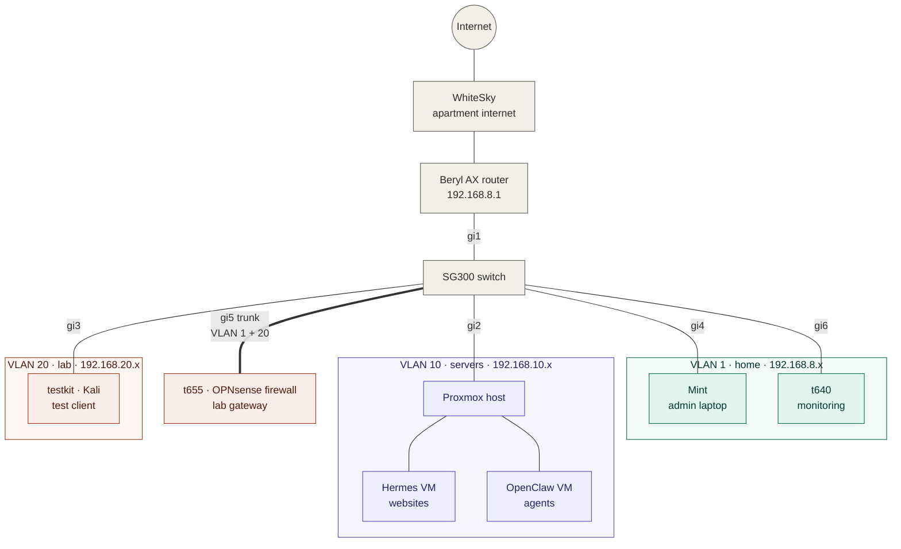
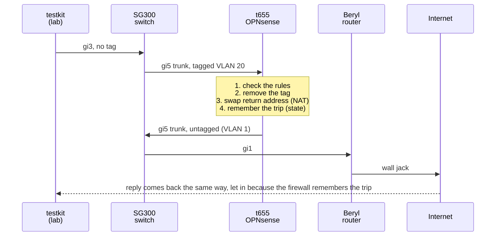
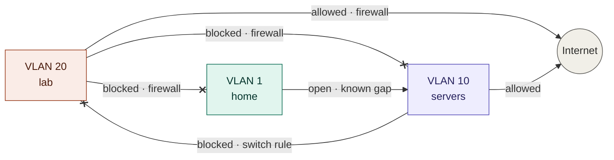
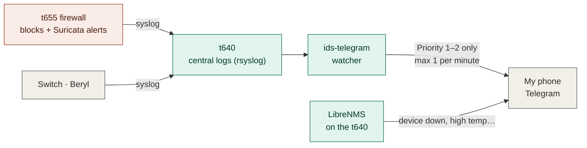

# Homelab

A homelab built from scratch, documented as a learning log and a portfolio — working toward a cloud network engineering role.

| At a glance | |
|---|---|
| **Rooms (VLANs)** | 3: home, servers, lab |
| **Firewall** | OPNsense, stateful, with Suricata intrusion detection |
| **Monitoring** | LibreNMS on 7 devices, central logs, alerts to my phone |
| **Hosting** | My websites, self-hosted on Proxmox (moved off AWS) |
| **Documented** | 53 sessions in [`runbooks/`](runbooks/) |

**Contents:** [Goals](#goals) · [Network map](#network-map) · [How the lab reaches the internet](#how-the-lab-reaches-the-internet) · [Segmentation](#segmentation-a-sign-and-a-guard) · [Monitoring](#monitoring-and-alerts) · [Known gap](#known-gap) · [Hardware](#hardware) · [What's next](#whats-next) · [Something I learned](#something-i-learned)

## Goals

I want to be a cloud network engineer. This lab helps me get there by practicing with a real network — VLANs, routing, firewalls, and monitoring — so that when I get the job, I already have experience.

1. **Cut cloud costs** — done: every workload moved off AWS onto owned hardware, and EC2 is decommissioned.
2. **Own the infrastructure** — full control, top to bottom, instead of renting it.
3. **Build a security portfolio** — hands-on practice toward CompTIA Network+ (N10-009) and a WGU degree in cloud network engineering and security (AWS track), including a live honeypot that captured real internet attackers (now retired).

## Network map

> [!TIP]
> On GitHub, hover the diagram for zoom and pan controls. Click a room underneath to see every device in it.



| Line | Meaning |
|---|---|
| **Thick** | Trunk: one cable carrying two VLANs (802.1Q tagged) |
| **Dotted** | Parked VM, shut down for now |

| Color | Room | What lives there |
|---|---|---|
| 🟩 Green | VLAN 1 · home / management | My admin devices and the monitoring box |
| 🟪 Purple | VLAN 10 · servers | Proxmox and the websites |
| 🟧 Orange | VLAN 20 · lab | Test and attack machines. They can reach the internet only |

<details>
<summary><b>🟩 VLAN 1 · home / management · 192.168.8.x</b></summary>

| Port | Device | Address | Job |
|---|---|---|---|
| gi1 | Beryl AX router | 192.168.8.1 | Internet in and out, home WiFi (FBI #4 / #5), hands out home addresses |
| gi4 | Mint | 192.168.8.142 | My admin laptop: where I manage everything from |
| gi5 | t655 (outside side) | 192.168.8.195 | The firewall's face toward home and the internet |
| gi6 | t640-mon | 192.168.8.24 | Monitoring: LibreNMS graphs, central logs, phone alerts |
| — | SG300 switch | 192.168.8.165 | The switch's own management address |

</details>

<details>
<summary><b>🟪 VLAN 10 · servers · 192.168.10.x</b></summary>

| Port | Device | Address | Job |
|---|---|---|---|
| gi2 | Proxmox host (Lenovo M720q) | 192.168.10.2 | Runs the virtual machines |
| — | Hermes VM | 192.168.10.206 | Hosts my websites |
| — | OpenClaw VM | 192.168.10.10 | Runs my OpenClaw agents |

Gateway: the switch, 192.168.10.1. The Beryl has a return route for 192.168.10.0/24 pointing at the switch (192.168.8.165). Without it, server traffic reaches the internet but the replies never find their way back (asymmetric routing).

</details>

<details>
<summary><b>🟧 VLAN 20 · lab · 192.168.20.x</b></summary>

| Port | Device | Address | Job |
|---|---|---|---|
| gi3 | testkit (Kali) | 192.168.20.100–199 (DHCP) | Test client and attack box |
| gi5 | t655 (inside side) | 192.168.20.1 | Lab gateway: DHCP, DNS, stateful rules, Suricata IDS |

The lab's only way out is through the firewall.

</details>

## How the lab reaches the internet

**testkit → switch → firewall → switch → Beryl → internet**

testkit's cable is on gi3, so its first stop is the switch, and it leaves the switch tagged VLAN 20 (802.1Q). It goes to the guard (OPNsense on the t655), who sees the VLAN 20 tag, checks the rules, takes the label off, makes the return address its own address (NAT), and remembers the trip so the reply can come back the same way (stateful). Then the guard sends it back to the switch without the label, so it's on VLAN 1, and the switch passes it to the Beryl and out to the internet.



> [!NOTE]
> The switch passes the same packet twice: once on the way to the firewall and once on the way out. On this path the switch only forwards. The firewall is the only thing checking rules.

## Segmentation: a sign and a guard

Each room has rules about where its traffic can go. Two different things enforce them:

- **The switch's rules are like a sign on a door.** They check every packet, every time, and don't remember anything (stateless).
- **The firewall is like a guard.** It checks the rules on the way out and remembers the trip, so the reply can get back in without needing its own rule (stateful).



| Room | Enforced by | Type | Can reach | Blocked from |
|---|---|---|---|---|
| 🟧 VLAN 20 · lab | Guard: OPNsense on the t655 | Stateful, every block logged | Internet only | Every private network, and the firewall itself |
| 🟪 VLAN 10 · servers | Sign: `vlan10-policy` on switch port gi2 | Stateless | Internet, home | The lab, the switch's management address |
| 🟩 VLAN 1 · home | Nothing yet | — | Everything, including the servers | — (see Known gap) |

<details>
<summary><b>The firewall's lab rules (checked top to bottom, first match wins)</b></summary>

| # | Action | From | To | Why |
|---|---|---|---|---|
| 1 | Allow | Lab | Firewall, port 53 | Name lookups (DNS) |
| 2 | Allow | Lab | Firewall, ping | Troubleshooting |
| 3 | Block + log | Lab | The firewall itself | No logging in to the firewall from the lab |
| 4 | Block + log | Lab | Every private network | No home, no servers, nothing private |
| 5 | Allow + log | Lab | Anything else | The internet |

Everything not allowed is blocked by default.

</details>

### Why I took the switch's rule off the lab

I took the rule off because when something was blocked by the switch, it didn't report to the firewall. Now things go to the firewall and I can see it in the logs.

I found this during my first attack test: testkit tried to reach my laptop and was blocked, but the firewall's log showed nothing, because the switch had already stopped it. After I took the switch's rule off, the same test was still blocked, and this time it showed up in the logs.

> [!IMPORTANT]
> An attack stopped by a device that doesn't log is invisible. Nothing got weaker: the firewall blocks everything the switch rule did, and the rule is still saved on the switch, so it can go back on with one command.

## Monitoring and alerts

The **t640 (t640-mon)** is the lab's monitoring box. It does two jobs that work in opposite directions:

| | SNMP | Syslog |
|---|---|---|
| **Direction** | The t640 *asks* each device "how are you doing?" on a schedule | Devices *tell* the t640 "this just happened" |
| **Program on the t640** | LibreNMS | rsyslog |
| **What I get** | Health graphs for 7 devices | Firewall blocks, Suricata alerts, switch and router events, all in one place |

LibreNMS shows me how all of the devices and ports are doing: memory, temperature, CPU and more, and it uses SNMP. When the firewall blocks something, it ends up on the t640 because the logs go there, with rsyslog.



### Suricata: the camera on the lab

Suricata runs on the firewall and watches the lab's traffic for known attack patterns. It's in **IDS mode**: it raises an alert but doesn't block anything, so a bad rule can never break the network. The firewall rules do the blocking.

When Suricata sees something serious, the alert goes to the t640's logs, and a small watcher program sends it to my phone through Telegram. Each alert says how severe it is (priority 1 is highest) and which known attack pattern it matched.

<details>
<summary><b>A real alert from my lab</b></summary>

```
suricata: [1:2100498:7] GPL ATTACK_RESPONSE id check returned root
  [Classification: Potentially Bad Traffic] [Priority: 2]
  {TCP} 192.168.20.185:58802 -> 172.66.147.243:80
```

| Part | Meaning |
|---|---|
| `2100498` | The rule's ID. I can search the logs for it |
| `Priority: 2` | Severity: 1 = high, 2 = medium, 3 = low |
| `192.168.20.185 -> …:80` | testkit, talking to a website |

I triggered this one on purpose from testkit to prove the whole chain works, from the lab to my phone.

</details>

## Known gap

Proxmox is not behind the guard yet. The home room (VLAN 1) can still reach the servers, including the Proxmox login page. I found this myself by opening Proxmox from my phone on the home WiFi.

**Why the risk is low for now**

- Guests and other devices use the apartment's WiFi (WhiteSky-Prose), which has no way into my network. Only my admin laptops use my home WiFi.
- Proxmox still needs a password.

**What could still go wrong:** if my own laptop picked up malware, it could reach Proxmox before I noticed. That's why the fix is first on the list below.

## Hardware

| Device | Role | Notes |
|---|---|---|
| **Lenovo ThinkCentre M720q** (`pve-node1`) | Proxmox VE host, **64 GB RAM** | Runs Hermes (my websites) and OpenClaw (my agents), with room left for the SIEM |
| **HP t655** (`t655-fw`) | Firewall | OPNsense 26.7: lab gateway, DHCP, DNS, stateful rules, Suricata IDS |
| **HP t640** (`t640-mon`) | Monitoring | Debian 13, key-only SSH: LibreNMS, central logs, phone alerts |
| **Cisco SG300-10** | Switch | Layer 3: routes home ↔ servers, VLAN trunk to the firewall |
| **GL.iNet Beryl AX** | Edge router | Wired WAN with automatic WiFi failover (tested by pulling the cable: zero packets lost) |
| **Lenovo 100e** (`testkit`) | Lab client | Kali Linux: test and attack box on the lab VLAN |
| **Mint laptop** | Admin workstation | Where I manage everything from |

**Backups:** nightly local snapshots plus offsite copies to Cloudflare R2.

**Retired:** a Hetzner VPS running four honeypots (Cowrie, Dionaea, mailoney, and a WordPress honeypot I built) that captured real attacker traffic. Final write-up: [`SESSION-43`](runbooks/SESSION-43-final-pull-and-lifetime-close-2026-10-30.md).

Details for each machine are in [`hardware/`](hardware/) and [`services/`](services/).

## What's next

- [x] Lab (VLAN 20) behind the firewall — [`SESSION-51`](runbooks/SESSION-51-phase1-vlan20-behind-opnsense-build-2026-11-12.md), proven in [`SESSION-52`](runbooks/SESSION-52-phase1-proven-first-red-blue-exercise-2026-11-13.md)
- [x] Monitoring, central logs, and alerts to my phone — [`SESSION-44`](runbooks/SESSION-44-t640-mon-syslog-snmp-firewall-librenms-2026-11-06.md) through [`SESSION-53`](runbooks/SESSION-53-suricata-ids-on-lab-first-detection-2026-11-13.md)
- [ ] **Move everything behind the firewall**, starting with the servers (VLAN 10). This closes the known gap
- [x] **Proxmox host RAM 16 → 64 GB**: [`SESSION-56`](runbooks/SESSION-56-ram-upgrade-64gb-openclaw-back-2026-11-13.md)
- [ ] **Wazuh SIEM** on the Proxmox host (now has the RAM for it)
- [ ] Monitoring box RAM 4 → 32 GB
- [ ] **Put all of the admin dashboards on their own VLAN** (a management VLAN), so only my admin devices can reach them

## Repo structure

| Folder | What's in it |
|---|---|
| [`runbooks/`](runbooks/) | Session-by-session build logs: not just *what* I did but *why*, including mistakes and how I found them |
| [`hardware/`](hardware/) | One page per machine: specs, ports, addresses, config |
| [`services/`](services/) | Per-VM and per-service reference docs (current state, not history) |

Every session is written as if someone else — a hiring manager, or future me — needs to understand the reasoning, not just the commands.

## Something I learned

When I finished the OPNsense setup wizard, I lost access to the web GUI. The wizard had turned the packet filter back on, and there was no rule allowing my laptop in. I used `pfctl -d` to disable the filter, added a pass rule for my laptop only, turned it back on with `pfctl -e`, and reloaded the page to prove the rule worked with the filter on. Now when I'm locked out, I check whether the filter is enabled and what rules exist first.

More in `runbooks/` — especially `SESSION-42`, which covers two other near-misses from the same build.
