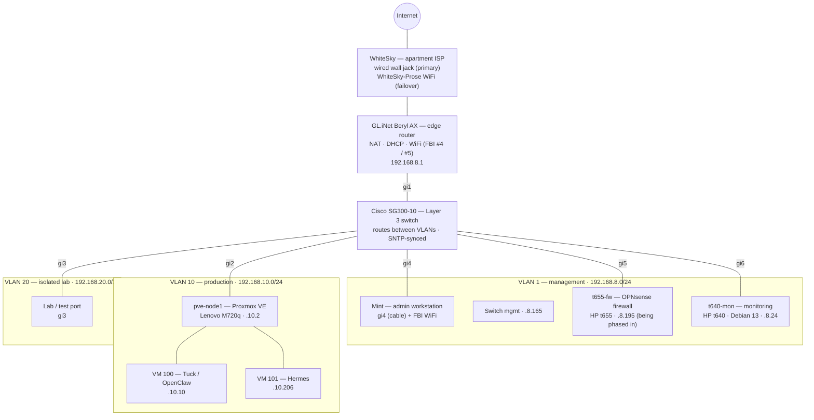
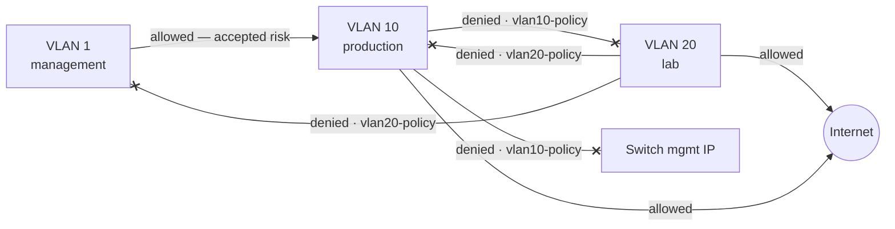

# Homelab

A homelab built from scratch, documented as a learning log and a portfolio — working toward a cloud network engineering role.

## Goals

I want to be a cloud network engineer. This lab helps me get there by practicing with a real network — VLANs, routing, firewalls, and monitoring — so that when I get the job, I already have experience.

1. **Cut cloud costs** — done: every workload moved off AWS onto owned hardware, and EC2 is decommissioned.
2. **Own the infrastructure** — full control, top to bottom, instead of renting it.
3. **Build a security portfolio** — hands-on practice toward CompTIA Network+ (N10-009) and a WGU degree in cloud network engineering and security (AWS track), including live honeypot operations against real internet attackers.

## Network map

The Beryl carries static return routes for VLAN 10 and VLAN 20 pointing at the
switch (`192.168.8.165`). Without them, traffic from those VLANs reaches the
internet but the replies never find their way back — asymmetric routing.

## Segmentation

The switch routes between VLANs, so isolation is enforced with explicit ACLs
rather than by leaving routes out. VLANs separate broadcast traffic; they are
not a security boundary on their own.

| ACL | Bound to | What it enforces |
|---|---|---|
| `vlan20-policy` | gi3, input | Lab can reach the internet only. Denied: production, the switch's management IP, the rest of VLAN 1. |
| `vlan10-policy` | gi2, input | Production can reach the internet and VLAN 1. Denied: the lab and the switch's management IP. |

Both were verified by function — ping and connection tests from a client in the
VLAN, not just by reading the config — and the config was confirmed to survive
a cold reload of the switch.

**How the ACLs work on this switch.** The SG300's 2011 firmware only binds ACLs
to physical ports, and only in the `input` direction. Each ACL therefore judges
traffic *leaving* its VLAN. The filtering is stateless — the switch has no
memory of connections — so rules are written by matching source and
destination addresses, the same model as an AWS Network ACL.

**Known gap, accepted for now.** Devices on the Beryl's WiFi (VLAN 1) can reach
production, including the Proxmox web UI. Nothing filters traffic *entering*
the switch from the Beryl (gi1). This was found by testing from a phone. The
fix has been dry-run on paper: an ACL on gi1, plus a host route so the admin
workstation isn't locked out. It's deferred because only admin devices use that
WiFi today. Proxmox still requires authentication.

## Current infrastructure

- **pve-node1** — Lenovo ThinkCentre M720q, running Proxmox VE 9.2 on VLAN 10, hosting two VMs:
  - **Tuck / OpenClaw** — a 12-agent AI system, migrated off AWS
  - **Hermes** — an AI gateway fleet, cut over from AWS EC2, RHEL 10
- **Cisco SG300-10** — managed switch in **Layer 3 (Router) mode**: inter-VLAN routing between management, production, and an isolated lab VLAN, with ACL-enforced segmentation (see above)
- **GL.iNet Beryl AX** — edge router on a wired WAN, with automatic WiFi failover tested by pulling the cable (zero packets lost)
- **t655-fw** — HP Elite t655 thin client running OPNsense 26.7. Installed WAN-only with the web GUI locked to the admin workstation; next it takes over routing for the lab VLAN as a stateful firewall (router-on-a-stick over an 802.1Q trunk)
- **t640-mon** — HP t640 thin client running Debian 13, hardened (key-only SSH, automatic security updates). Becoming the monitoring box: SNMP graphs, central syslog
- **fieldkit** — Lenovo 100e running Kali, a test client for the isolated lab VLAN
- **Hetzner VPS** — a multi-sensor honeypot stack (being retired) (Cowrie SSH/Telnet, Dionaea multi-protocol, a purpose-built WordPress HTTP honeypot, mailoney SMTP) capturing real attacker traffic, with Telegram alerting
- **Backups** — nightly local snapshots plus offsite copies to Cloudflare R2

## Repo structure

- `hardware/` — physical machine specs and purchase records
- `services/` — per-VM and per-service reference docs (current state, not history)
- `runbooks/` — session-by-session build logs, written to capture not just *what* was done but *why*, including mistakes and how they were diagnosed

## Why this repo exists

Every session here is documented as if someone else — a hiring manager, a future me — needs to understand the reasoning, not just the commands. The goal is to show real troubleshooting, real incident analysis (see the honeypot logs), and real infrastructure decisions, not a polished after-the-fact summary.

## Status

Actively worked, roughly session-by-session. See `runbooks/` for the most recent entries.

**Current phase:** I'm building a firewall and a monitoring system. The switch's ACLs are **stateless**: they have no memory and check every packet against the rules, so a reply looks the same as a new connection. That's why VLAN 10 → VLAN 1 has to stay open today. OPNsense is **stateful**: it keeps a list of connections it has allowed, so replies come back automatically while new connections still have to pass the rules. That lets me close that gap.

## Something I learned

When I finished the OPNsense setup wizard, I lost access to the web GUI. The wizard had turned the packet filter back on, and there was no rule allowing my laptop in. I used `pfctl -d` to disable the filter, added a pass rule for my laptop only, turned it back on with `pfctl -e`, and reloaded the page to prove the rule worked with the filter on. Now when I'm locked out, I check whether the filter is enabled and what rules exist first.

More in `runbooks/` — especially `SESSION-42`, which covers two other near-misses from the same build.
